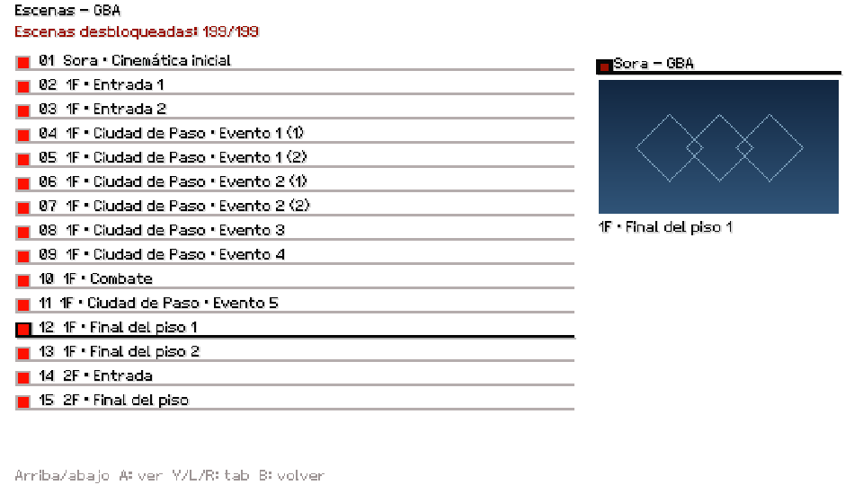
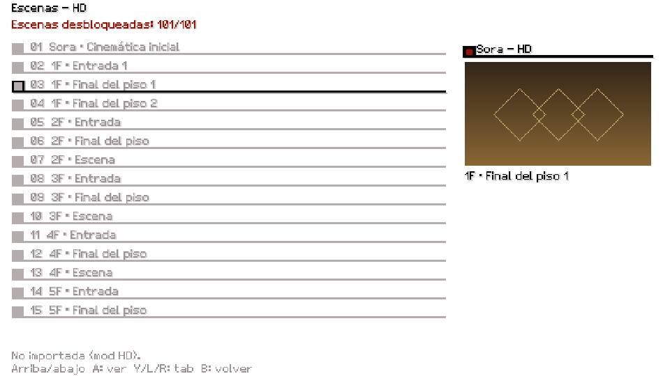

# Fondo mínimo cuando no existe una preview

Pendiente explícito del usuario: dos variantes visuales ligeras, sin bordes
grises ni texto técnico, sólo como último recurso. El poster real GBA/HD y
el poster GBA usado mientras llega HD mantienen prioridad.

`ScenePreviewBackdrop` dibuja un gradiente azul para proveedorGBA y dorado
para proveedorHD, con un motivo de cadena. No abre archivos, crea texturas,
decodifica, reserva memoria, modifica cachés ni cambia el input. Sólo se llama
si `PortSceneGalleryPreview` devuelveNULL. El modo híbrido sigue el proveedor
de la escena seleccionada. No sustituye ni certifica la medición de latencia
del worker de previews.

## Evidencia

- `python port/tools/test_gallery_empty_backdrop.py`: primeroRED porque faltaba
  el fondo; GREEN con función real extraída, opacidad, exterior intacto,
  variantes diferentes y tamaños pequeños/cero. Ccompilado con warnings como
  errores. Genera imágenes de la función para inspección.
- Build EU incremental: `ninja -f build/pc-eu/build.ninja -j1 build/pc-eu/khcom.exe`,
  sólo port_ui y enlace. ExeSHA256
  `f347461f94e523f3f7992d37703d94638e2ec3d4e5b63bfa3319325ce475e994`.
- Juego real Windows/Direct3D11 oculto y sin audio,960x540, GBA/HD con poster
  y sin poster. Controles conservan la imagen real; fallback coloreado visible.
  Para probar ausencia sin introducir un override de producción, el depurador
  del harness escribió0 en `sPreviewReady` del proceso hijo propio después de
  seleccionar evento10; para HD limpió también `sPreviewFallback`, simulando
  que tampoco existía el poster GBA. Direcciones derivadas delCOFF exacto.
  No simula ni demuestra un OOM real. No se tocó la lógica/progreso del juego ni
  una instalación del usuario: sólo flags de presentación del hijo aislado.
- Registros privados: `khcom-crash-diagnostics/build/gallery-backdrop-qa` y
  `gallery-backdrop-qa-hd-missing`. Los archivos publicados de2.1 permanecen
  intactos; es un ajuste posterior enmain, no incluido retroactivamente.

